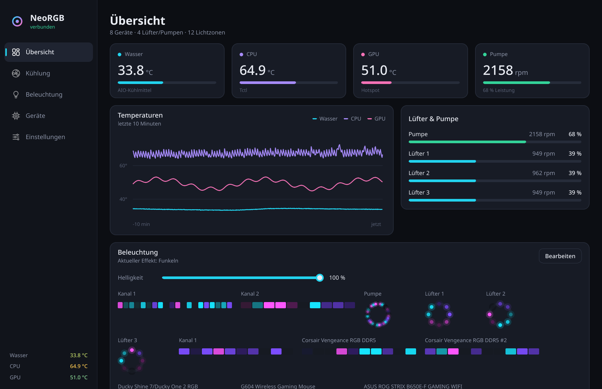
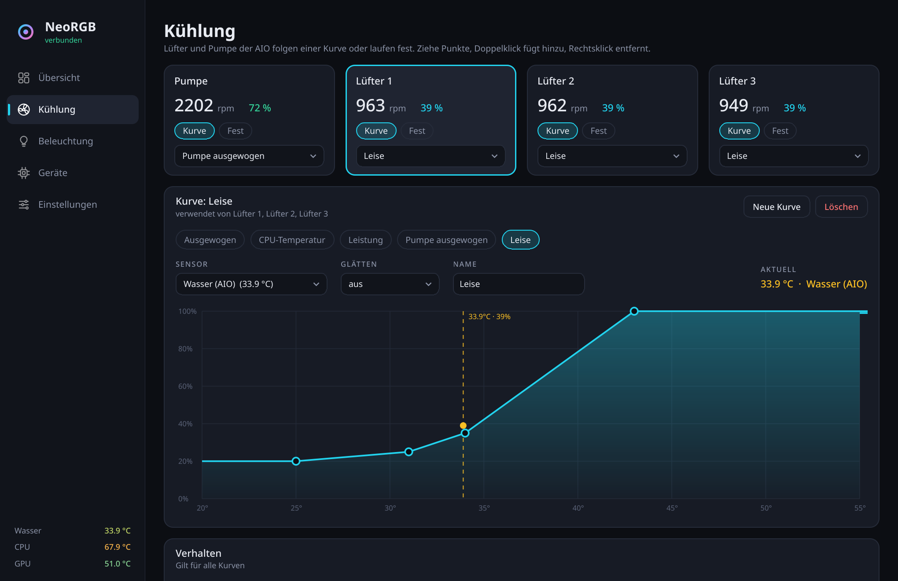
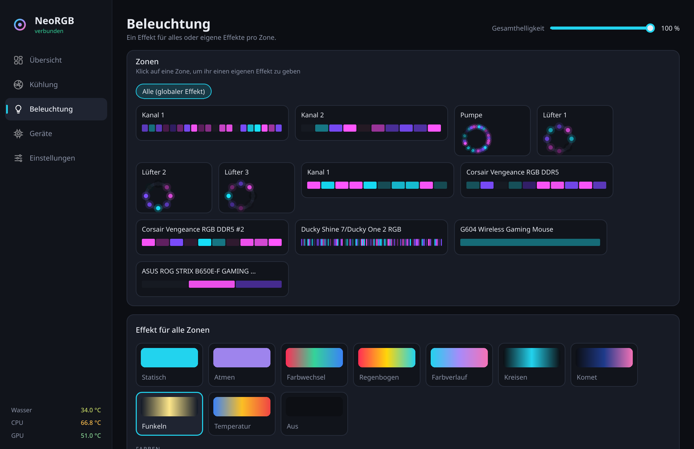
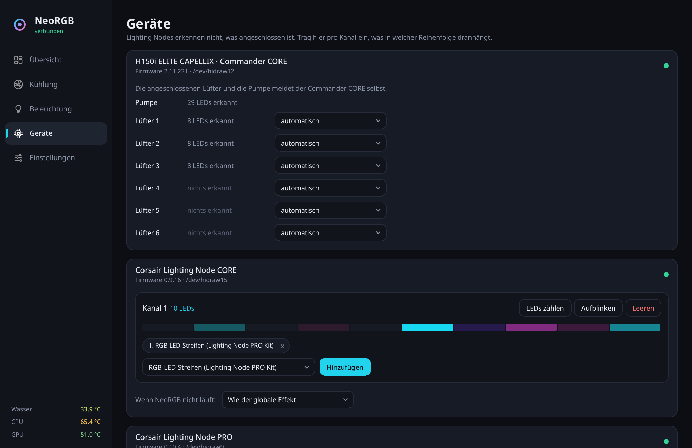
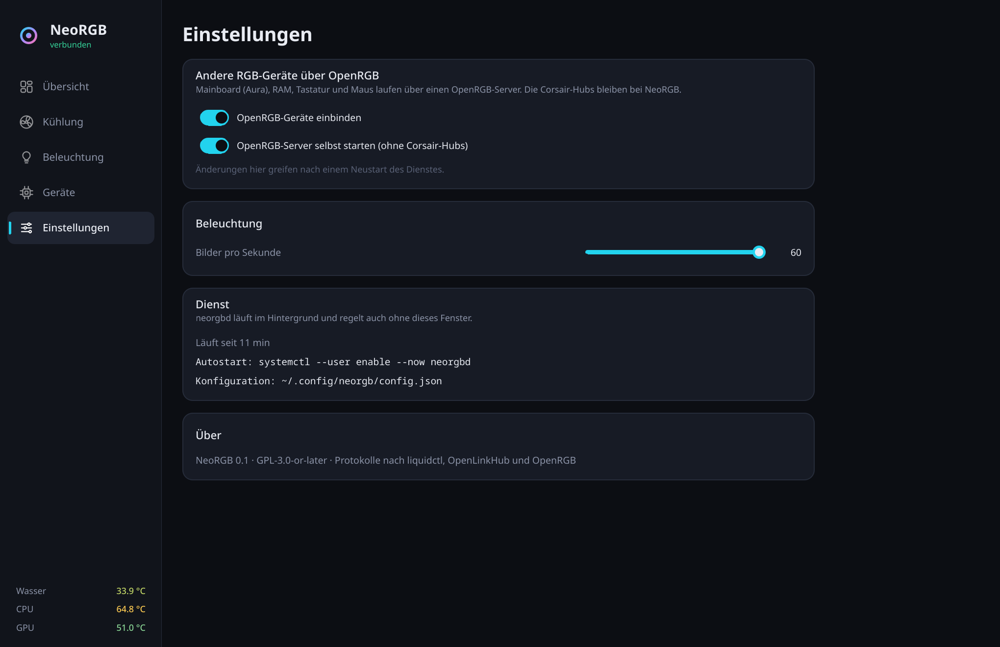

# NeoRGB

RGB-Beleuchtung und Corsair-AIO-/Lüftersteuerung für Linux, in einem Dienst
und einer Oberfläche.



- **Corsair direkt:** iCUE Commander CORE / CORE XT / ST (Pumpe, Lüfter,
  Wassertemperatur, RGB), Lighting Node PRO / CORE, LS100, LT100
- **Lüfter und Pumpe:** Kurven nach Wasser-, CPU-, GPU- oder jedem anderen
  hwmon-Sensor, mit Hysterese, Glättung und begrenzter Regelgeschwindigkeit.
  Fester Wert pro Kanal möglich.
- **Ausfallsicher:** Die Kurven werden zusätzlich in der AIO gespeichert.
  Läuft NeoRGB nicht (Boot, Absturz, Dienst gestoppt), regelt die AIO selbst
  nach Wassertemperatur. Die Pumpe fällt nie unter 50 %. Ab 50 °C Wasser gehen
  alle Kanäle auf 100 %. Fällt der Sensor einer Kurve aus, laufen nur deren
  Kanäle auf einer einstellbaren Leistung (Standard 100 %).
- **WLED** über das Netzwerk, per IP-Adresse eingetragen
- **Alles andere** (ASUS Aura, RAM, Tastatur, Maus) über einen privaten
  OpenRGB-Server, den NeoRGB selbst startet. In dessen Konfiguration sind die
  Corsair-Hubs abgeschaltet, damit nie zwei Programme gleichzeitig auf dasselbe
  Gerät zugreifen.

## Installieren

Fertige Pakete gibt es unter
[Releases](https://github.com/Noronus/neorgb/releases/latest).

| System | Befehl |
|---|---|
| Arch, CachyOS | `sudo pacman -U neorgb-0.1.0-1-any.pkg.tar.zst` |
| Debian 13 | `sudo apt install ./neorgb_0.1.0-1_all.deb` |
| Fedora 44 | `sudo dnf install ./neorgb-0.1.0-1.fc44.noarch.rpm` |

Danach einmal:

```sh
sudo udevadm control --reload && sudo udevadm trigger   # Zugriff auf die Corsair-Geräte
systemctl --user enable --now neorgbd                  # Dienst starten, auch nach jedem Login
```

„NeoRGB“ liegt dann im Startmenü. Kommandozeile: `neorgbctl status`.

Für ASUS Aura, RAM, Tastatur, Maus und andere Nicht-Corsair-Geräte braucht es
zusätzlich `openrgb` samt seinen udev-Regeln. Die Pakete empfehlen es nur.

**Ohne Paket**, direkt aus dem Git-Checkout, ohne root:

```sh
./install.sh
systemctl --user enable --now neorgbd
```

Voraussetzungen dafür: Python ≥ 3.11, PySide6 und die OpenRGB-udev-Regeln. Die
geben Zugriff auf `/dev/hidraw*` und I²C.

**Pakete selbst bauen**: `packaging/build-packages.sh` baut alle drei in
Containern (podman oder docker), installiert jedes Paket probeweise und lädt
die Oberfläche einmal. Das Ergebnis liegt in `dist/`.

## Bilder

| | |
|---|---|
|  **Kühlung**: Kurven pro Lüfter und Pumpe, Punkte ziehen |  **Beleuchtung**: ein Effekt für alles oder pro Zone |
|  **Geräte**: was an den Lighting Nodes hängt, LEDs zählen |  **Einstellungen** |

## WLED

Unter **Geräte** → „WLED-Gerät hinzufügen“ die IP-Adresse eintragen (z. B.
`10.0.5.120`). NeoRGB fragt die LED-Anzahl beim Controller ab und schickt die
Effekte per DDP (UDP-Port 4048). Der Streifen erscheint danach unter
**Beleuchtung** als eigene Zone. Ist der WLED aus, schaltet NeoRGB ihn beim
Verbinden ein. Läuft NeoRGB nicht, zeigt WLED nach ein paar Sekunden wieder
seinen eigenen Effekt.

## Lighting Nodes einrichten

Lighting Node PRO/CORE erkennen nicht, was angeschlossen ist. Unter
**Geräte** beim Kanal den Typ wählen (z. B. „RGB-LED-Streifen“) und
**LEDs zählen** drücken: Jedes Teil am Kanal leuchtet dann in einer eigenen
Farbe (Rot, Grün, Blau, …). Unten anklicken, wie viele Farben zu sehen sind,
fertig. Ist die Anzahl zu klein, behalten die LEDs dahinter ihre alte Farbe.
Dann leuchten Streifen nur teilweise.

Ist ein Kanal leer, fasst NeoRGB ihn nicht an. Er behält das Licht, das im
Hub gespeichert ist.

## Dateien

| Was | Wo |
|---|---|
| Einstellungen | `~/.config/neorgb/config.json` |
| Original-Hardwarekurven der AIO (vor dem ersten Schreiben) | `~/.config/neorgb/backup/` |
| privater OpenRGB-Server | `~/.config/neorgb/openrgb/` |
| Socket | `$XDG_RUNTIME_DIR/neorgb.sock` |

## Aufbau

```
neorgb/daemon.py          Dienst: Geräte-Threads, Effekte, Lüfterregelung, Socket-API
neorgb/devices/           Commander CORE, Lighting Node, OpenRGB-SDK-Client
neorgb/fancontrol.py      Kurven, Hysterese, Rampen, Failsafe
neorgb/effects.py         Software-Effekte
neorgb/gui/               PySide6/QML-Oberfläche
neorgb/cli.py             neorgbctl
```

Protokolle nach liquidctl, OpenLinkHub und OpenRGB (alle GPL). NeoRGB steht
unter GPL-3.0-or-later.
